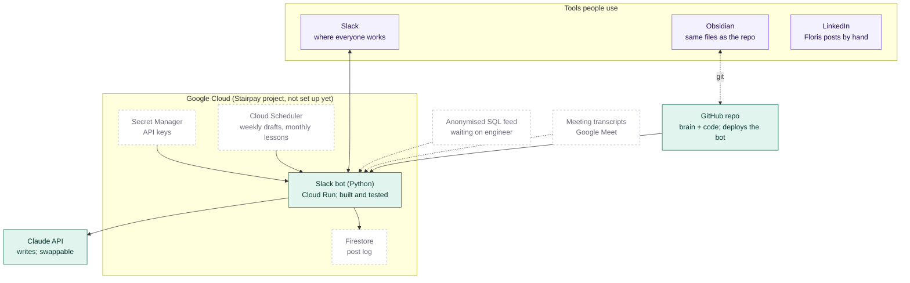

# Tech stack

Solid = in place. Dashed = planned, not connected yet (as of 2026-10-28).

| Layer | Choice | Why | Swappable? |
|---|---|---|---|
| Interface | Slack (bot DMs, buttons, forms) | Where the team already works | Add Notion/Docs as extra outputs |
| Code | Python, Slack Bolt | Simple, well supported | n/a |
| Hosting | Google Cloud Run (+ Cloud Scheduler) | You already use it; scales to zero | Any container host |
| Storage | SQLite locally, Firestore on Cloud Run | No database to manage | `store.py` adapter (Postgres possible) |
| Writing | Claude API | Default model | `llm.py`: one file to change |
| Visuals | HTML + Playwright, brand tokens, Poppins | Exact numbers, on-brand | n/a |
| Source of truth | GitHub repo = Obsidian vault folder | Any LLM, any device | n/a |
