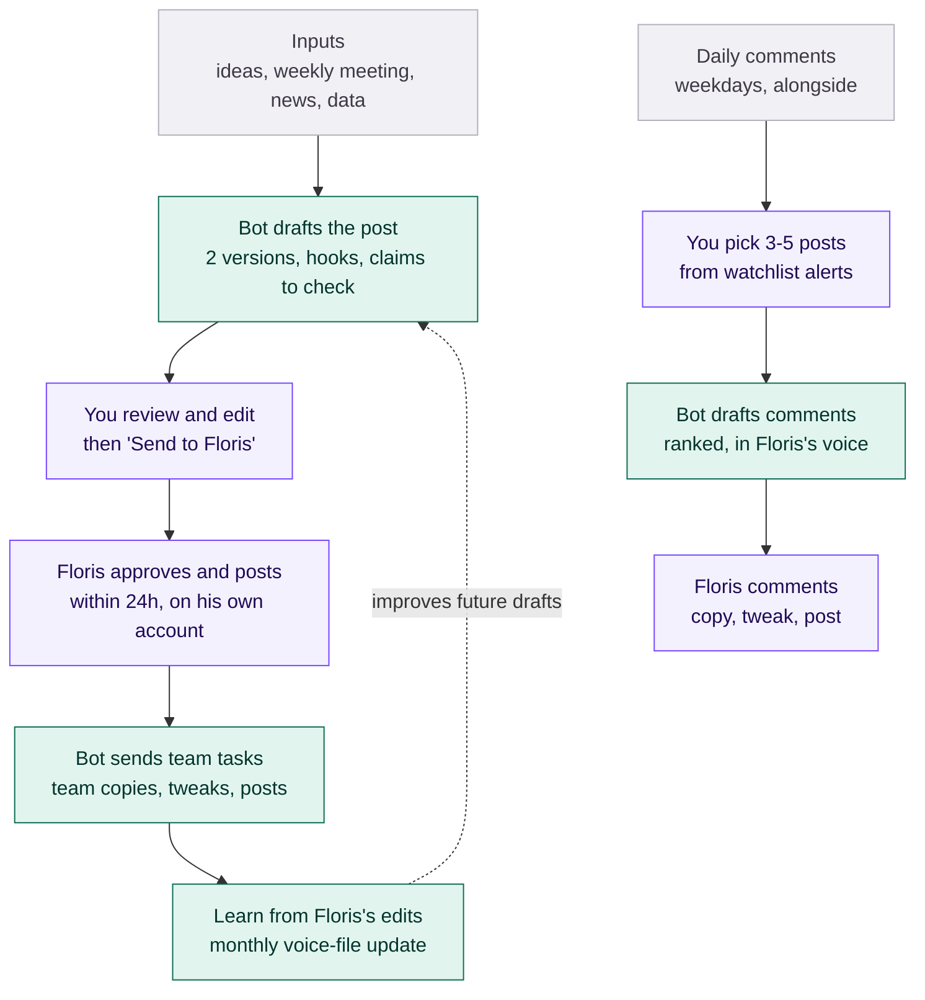

# Workflow at a glance

Purple = people, teal = Slack bot. Obsidian renders this diagram.

Details: `ARCHITECTURE.md` (design), `docs/SLACK_BOT.md` (bot), `playbooks/` (per post type), `playbooks/daily-comments.md`.
