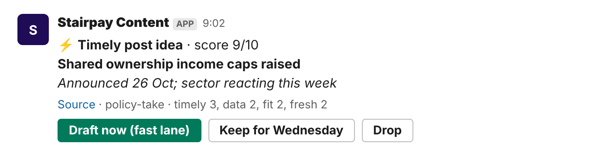
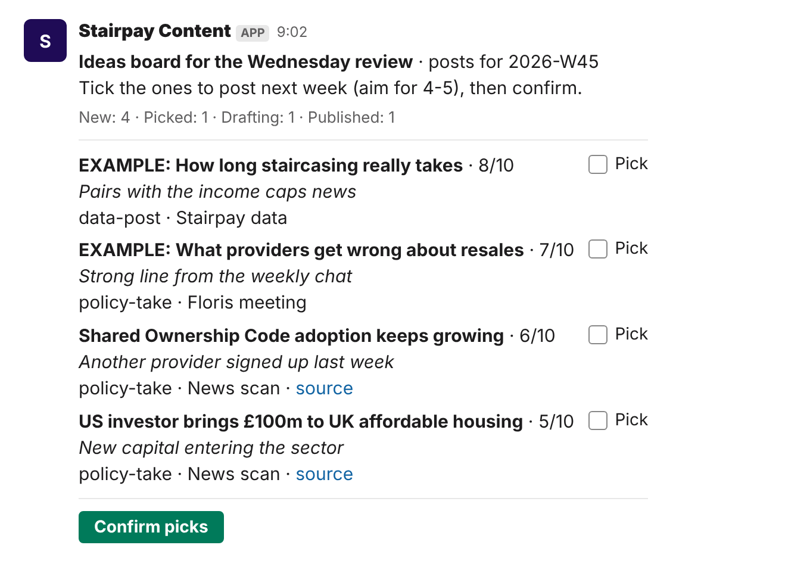
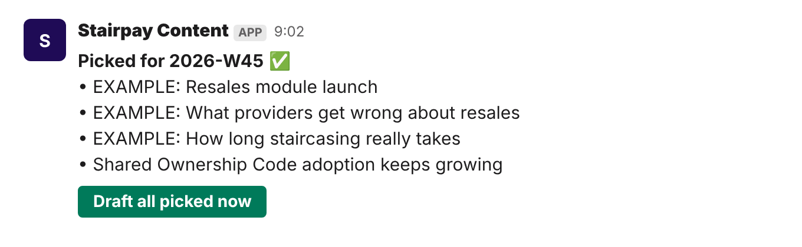
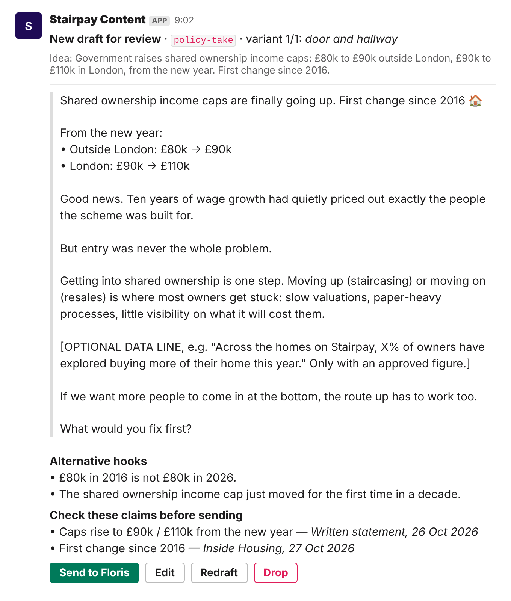
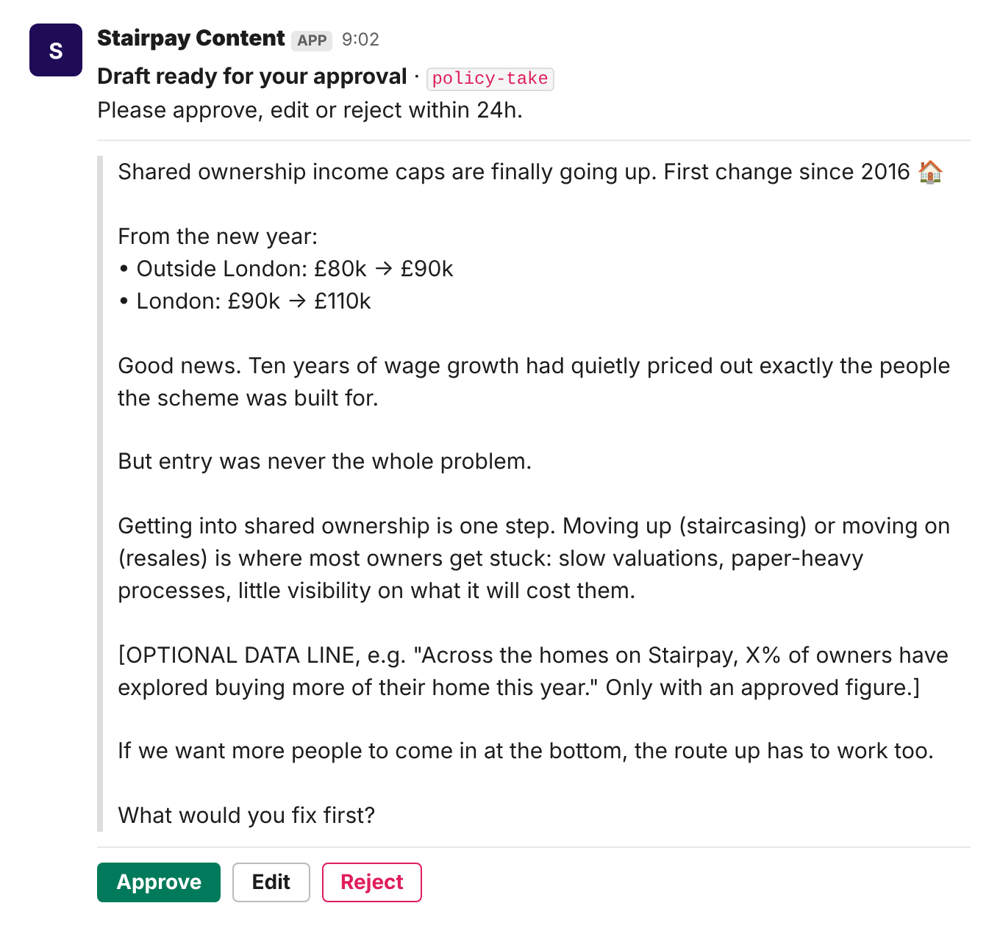
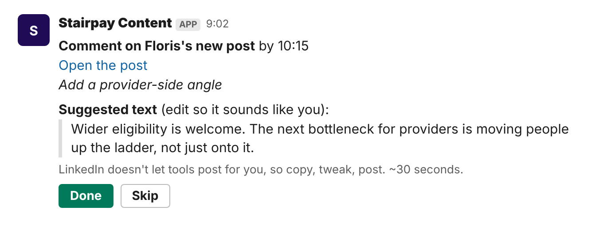
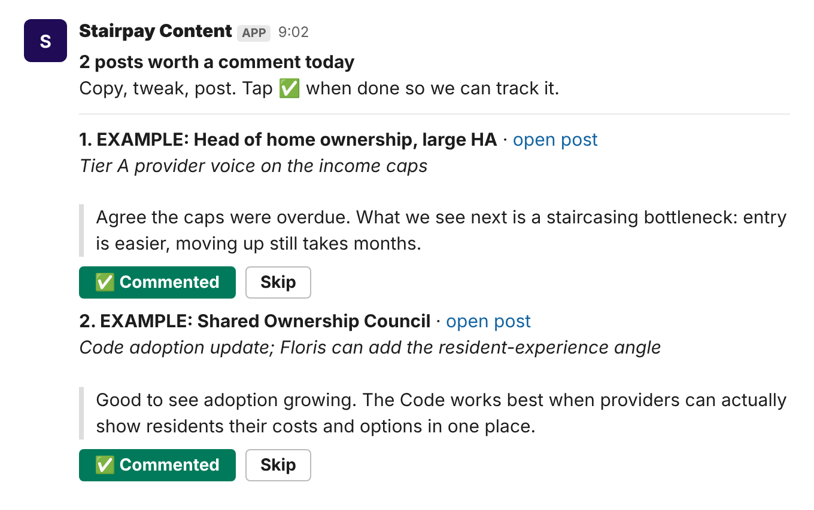

# Slack mock-ups

Exact Block Kit payloads the bot sends (generated by `scripts/make_mockups.py` from the bot's own code).
Each `.png` is an approximate preview; open a link while signed in to Slack to see it rendered in Slack's Block Kit Builder (buttons are inert there).

- [news alert](https://app.slack.com/block-kit-builder/#%7B%22blocks%22%3A%5B%7B%22type%22%3A%22section%22%2C%22text%22%3A%7B%22type%22%3A%22mrkdwn%22%2C%22text%22%3A%22%5Cu26a1%20%2ATimely%20post%20idea%2A%20%5Cu00b7%20score%209/10%5Cn%2AShared%20ownership%20income%20caps%20raised%2A%5Cn_Announced%2026%20Oct%3B%20sector%20reacting%20this%20week_%22%7D%7D%2C%7B%22type%22%3A%22context%22%2C%22elements%22%3A%5B%7B%22type%22%3A%22mrkdwn%22%2C%22text%22%3A%22%3Chttps%3A//www.insidehousing.co.uk/news/government-announces-increase-to-shared-ownership-income-caps-99295%7CSource%3E%20%5Cu00b7%20policy-take%20%5Cu00b7%20timely%203%2C%20data%202%2C%20fit%202%2C%20fresh%202%22%7D%5D%7D%2C%7B%22type%22%3A%22actions%22%2C%22elements%22%3A%5B%7B%22type%22%3A%22button%22%2C%22text%22%3A%7B%22type%22%3A%22plain_text%22%2C%22text%22%3A%22Draft%20now%20%28fast%20lane%29%22%2C%22emoji%22%3Atrue%7D%2C%22action_id%22%3A%22news_draft%22%2C%22value%22%3A%22idea_cbe863f386%22%2C%22style%22%3A%22primary%22%7D%2C%7B%22type%22%3A%22button%22%2C%22text%22%3A%7B%22type%22%3A%22plain_text%22%2C%22text%22%3A%22Keep%20for%20Wednesday%22%2C%22emoji%22%3Atrue%7D%2C%22action_id%22%3A%22news_keep%22%2C%22value%22%3A%22idea_cbe863f386%22%7D%2C%7B%22type%22%3A%22button%22%2C%22text%22%3A%7B%22type%22%3A%22plain_text%22%2C%22text%22%3A%22Drop%22%2C%22emoji%22%3Atrue%7D%2C%22action_id%22%3A%22news_drop%22%2C%22value%22%3A%22idea_cbe863f386%22%7D%5D%7D%5D%7D) · `1_news_alert.json`
- [board digest wednesday](https://app.slack.com/block-kit-builder/#%7B%22blocks%22%3A%5B%7B%22type%22%3A%22section%22%2C%22text%22%3A%7B%22type%22%3A%22mrkdwn%22%2C%22text%22%3A%22%2AIdeas%20board%20for%20the%20Wednesday%20review%2A%20%5Cu00b7%20posts%20for%202026-W45%5CnTick%20the%20ones%20to%20post%20next%20week%20%28aim%20for%204-5%29%2C%20then%20confirm.%22%7D%7D%2C%7B%22type%22%3A%22context%22%2C%22elements%22%3A%5B%7B%22type%22%3A%22mrkdwn%22%2C%22text%22%3A%22New%3A%204%20%5Cu00b7%20Picked%3A%201%20%5Cu00b7%20Drafting%3A%201%20%5Cu00b7%20Published%3A%201%22%7D%5D%7D%2C%7B%22type%22%3A%22divider%22%7D%2C%7B%22type%22%3A%22section%22%2C%22block_id%22%3A%22pick_idea_ea507acf56%22%2C%22text%22%3A%7B%22type%22%3A%22mrkdwn%22%2C%22text%22%3A%22%2AEXAMPLE%3A%20How%20long%20staircasing%20really%20takes%2A%20%5Cu00b7%208/10%5Cn_Pairs%20with%20the%20income%20caps%20news_%5Cndata-post%20%5Cu00b7%20Stairpay%20data%22%7D%2C%22accessory%22%3A%7B%22type%22%3A%22checkboxes%22%2C%22action_id%22%3A%22board_tick%22%2C%22options%22%3A%5B%7B%22text%22%3A%7B%22type%22%3A%22mrkdwn%22%2C%22text%22%3A%22Pick%22%7D%2C%22value%22%3A%22idea_ea507acf56%22%7D%5D%7D%7D%2C%7B%22type%22%3A%22section%22%2C%22block_id%22%3A%22pick_idea_34cb325249%22%2C%22text%22%3A%7B%22type%22%3A%22mrkdwn%22%2C%22text%22%3A%22%2AEXAMPLE%3A%20What%20providers%20get%20wrong%20about%20resales%2A%20%5Cu00b7%207/10%5Cn_Strong%20line%20from%20the%20weekly%20chat_%5Cnpolicy-take%20%5Cu00b7%20Floris%20meeting%22%7D%2C%22accessory%22%3A%7B%22type%22%3A%22checkboxes%22%2C%22action_id%22%3A%22board_tick%22%2C%22options%22%3A%5B%7B%22text%22%3A%7B%22type%22%3A%22mrkdwn%22%2C%22text%22%3A%22Pick%22%7D%2C%22value%22%3A%22idea_34cb325249%22%7D%5D%7D%7D%2C%7B%22type%22%3A%22section%22%2C%22block_id%22%3A%22pick_idea_f59cc0d2ad%22%2C%22text%22%3A%7B%22type%22%3A%22mrkdwn%22%2C%22text%22%3A%22%2AShared%20Ownership%20Code%20adoption%20keeps%20growing%2A%20%5Cu00b7%206/10%5Cn_Another%20provider%20signed%20up%20last%20week_%5Cnpolicy-take%20%5Cu00b7%20News%20scan%20%5Cu00b7%20%3Chttps%3A//www.insidehousing.co.uk/news/specialist-older-peoples-housing-association-adopts-shared-ownership-code-99224%7Csource%3E%22%7D%2C%22accessory%22%3A%7B%22type%22%3A%22checkboxes%22%2C%22action_id%22%3A%22board_tick%22%2C%22options%22%3A%5B%7B%22text%22%3A%7B%22type%22%3A%22mrkdwn%22%2C%22text%22%3A%22Pick%22%7D%2C%22value%22%3A%22idea_f59cc0d2ad%22%7D%5D%7D%7D%2C%7B%22type%22%3A%22section%22%2C%22block_id%22%3A%22pick_idea_d3b602e51b%22%2C%22text%22%3A%7B%22type%22%3A%22mrkdwn%22%2C%22text%22%3A%22%2AUS%20investor%20brings%20%5Cu00a3100m%20to%20UK%20affordable%20housing%2A%20%5Cu00b7%205/10%5Cn_New%20capital%20entering%20the%20sector_%5Cnpolicy-take%20%5Cu00b7%20News%20scan%20%5Cu00b7%20%3Chttps%3A//news.google.com/rss/search%3Fq%3D%2522affordable%2Bhousing%2Binvestor%2522%2B%25C2%25A3100m%2BUK%7Csource%3E%22%7D%2C%22accessory%22%3A%7B%22type%22%3A%22checkboxes%22%2C%22action_id%22%3A%22board_tick%22%2C%22options%22%3A%5B%7B%22text%22%3A%7B%22type%22%3A%22mrkdwn%22%2C%22text%22%3A%22Pick%22%7D%2C%22value%22%3A%22idea_d3b602e51b%22%7D%5D%7D%7D%2C%7B%22type%22%3A%22divider%22%7D%2C%7B%22type%22%3A%22actions%22%2C%22elements%22%3A%5B%7B%22type%22%3A%22button%22%2C%22text%22%3A%7B%22type%22%3A%22plain_text%22%2C%22text%22%3A%22Confirm%20picks%22%2C%22emoji%22%3Atrue%7D%2C%22action_id%22%3A%22board_confirm%22%2C%22value%22%3A%222026-W45%22%2C%22style%22%3A%22primary%22%7D%5D%7D%5D%7D) · `2_board_digest_wednesday.json`
- [picks confirmed](https://app.slack.com/block-kit-builder/#%7B%22blocks%22%3A%5B%7B%22type%22%3A%22section%22%2C%22text%22%3A%7B%22type%22%3A%22mrkdwn%22%2C%22text%22%3A%22%2APicked%20for%202026-W45%2A%20%5Cu2705%5Cn%5Cu2022%20EXAMPLE%3A%20Resales%20module%20launch%5Cn%5Cu2022%20EXAMPLE%3A%20What%20providers%20get%20wrong%20about%20resales%5Cn%5Cu2022%20EXAMPLE%3A%20How%20long%20staircasing%20really%20takes%5Cn%5Cu2022%20Shared%20Ownership%20Code%20adoption%20keeps%20growing%22%7D%7D%2C%7B%22type%22%3A%22actions%22%2C%22elements%22%3A%5B%7B%22type%22%3A%22button%22%2C%22text%22%3A%7B%22type%22%3A%22plain_text%22%2C%22text%22%3A%22Draft%20all%20picked%20now%22%2C%22emoji%22%3Atrue%7D%2C%22action_id%22%3A%22board_draft_picked%22%2C%22value%22%3A%222026-W45%22%2C%22style%22%3A%22primary%22%7D%5D%7D%5D%7D) · `3_picks_confirmed.json`
- [owner review card](https://app.slack.com/block-kit-builder/#%7B%22blocks%22%3A%5B%7B%22type%22%3A%22section%22%2C%22text%22%3A%7B%22type%22%3A%22mrkdwn%22%2C%22text%22%3A%22%2ANew%20draft%20for%20review%2A%20%5Cu00b7%20%60policy-take%60%20%5Cu00b7%20variant%201/1%3A%20_door%20and%20hallway_%22%7D%7D%2C%7B%22type%22%3A%22context%22%2C%22elements%22%3A%5B%7B%22type%22%3A%22mrkdwn%22%2C%22text%22%3A%22Idea%3A%20Government%20raises%20shared%20ownership%20income%20caps%3A%20%5Cu00a380k%20to%20%5Cu00a390k%20outside%20London%2C%20%5Cu00a390k%20to%20%5Cu00a3110k%20in%20London%2C%20from%20the%20new%20year.%20First%20change%20since%202016.%22%7D%5D%7D%2C%7B%22type%22%3A%22divider%22%7D%2C%7B%22type%22%3A%22section%22%2C%22text%22%3A%7B%22type%22%3A%22mrkdwn%22%2C%22text%22%3A%22%3E%20Shared%20ownership%20income%20caps%20are%20finally%20going%20up.%20First%20change%20since%202016%20%5Cud83c%5Cudfe0%5Cn%3E%5Cn%3E%20From%20the%20new%20year%3A%5Cn%3E%20%5Cu2022%20Outside%20London%3A%20%5Cu00a380k%20%5Cu2192%20%5Cu00a390k%5Cn%3E%20%5Cu2022%20London%3A%20%5Cu00a390k%20%5Cu2192%20%5Cu00a3110k%5Cn%3E%5Cn%3E%20Good%20news.%20Ten%20years%20of%20wage%20growth%20had%20quietly%20priced%20out%20exactly%20the%20people%20the%20scheme%20was%20built%20for.%5Cn%3E%5Cn%3E%20But%20entry%20was%20never%20the%20whole%20problem.%5Cn%3E%5Cn%3E%20Getting%20into%20shared%20ownership%20is%20one%20step.%20Moving%20up%20%28staircasing%29%20or%20moving%20on%20%28resales%29%20is%20where%20most%20owners%20get%20stuck%3A%20slow%20valuations%2C%20paper-heavy%20processes%2C%20little%20visibility%20on%20what%20it%20will%20cost%20them.%5Cn%3E%5Cn%3E%20%5BOPTIONAL%20DATA%20LINE%2C%20e.g.%20%5C%22Across%20the%20homes%20on%20Stairpay%2C%20X%25%20of%20owners%20have%20explored%20buying%20more%20of%20their%20home%20this%20year.%5C%22%20Only%20with%20an%20approved%20figure.%5D%5Cn%3E%5Cn%3E%20If%20we%20want%20more%20people%20to%20come%20in%20at%20the%20bottom%2C%20the%20route%20up%20has%20to%20work%20too.%5Cn%3E%5Cn%3E%20What%20would%20you%20fix%20first%3F%22%7D%7D%2C%7B%22type%22%3A%22divider%22%7D%2C%7B%22type%22%3A%22section%22%2C%22text%22%3A%7B%22type%22%3A%22mrkdwn%22%2C%22text%22%3A%22%2AAlternative%20hooks%2A%5Cn%5Cu2022%20%5Cu00a380k%20in%202016%20is%20not%20%5Cu00a380k%20in%202026.%5Cn%5Cu2022%20The%20shared%20ownership%20income%20cap%20just%20moved%20for%20the%20first%20time%20in%20a%20decade.%22%7D%7D%2C%7B%22type%22%3A%22section%22%2C%22text%22%3A%7B%22type%22%3A%22mrkdwn%22%2C%22text%22%3A%22%2ACheck%20these%20claims%20before%20sending%2A%5Cn%5Cu2022%20Caps%20rise%20to%20%5Cu00a390k%20/%20%5Cu00a3110k%20from%20the%20new%20year%20%5Cu2014%20_Written%20statement%2C%2026%20Oct%202026_%5Cn%5Cu2022%20First%20change%20since%202016%20%5Cu2014%20_Inside%20Housing%2C%2027%20Oct%202026_%22%7D%7D%2C%7B%22type%22%3A%22actions%22%2C%22elements%22%3A%5B%7B%22type%22%3A%22button%22%2C%22text%22%3A%7B%22type%22%3A%22plain_text%22%2C%22text%22%3A%22Send%20to%20Floris%22%2C%22emoji%22%3Atrue%7D%2C%22action_id%22%3A%22review_send%22%2C%22value%22%3A%22post_f7500c4db7%22%2C%22style%22%3A%22primary%22%7D%2C%7B%22type%22%3A%22button%22%2C%22text%22%3A%7B%22type%22%3A%22plain_text%22%2C%22text%22%3A%22Edit%22%2C%22emoji%22%3Atrue%7D%2C%22action_id%22%3A%22review_edit%22%2C%22value%22%3A%22post_f7500c4db7%22%7D%2C%7B%22type%22%3A%22button%22%2C%22text%22%3A%7B%22type%22%3A%22plain_text%22%2C%22text%22%3A%22Redraft%22%2C%22emoji%22%3Atrue%7D%2C%22action_id%22%3A%22review_regen%22%2C%22value%22%3A%22post_f7500c4db7%22%7D%2C%7B%22type%22%3A%22button%22%2C%22text%22%3A%7B%22type%22%3A%22plain_text%22%2C%22text%22%3A%22Drop%22%2C%22emoji%22%3Atrue%7D%2C%22action_id%22%3A%22review_reject%22%2C%22value%22%3A%22post_f7500c4db7%22%2C%22style%22%3A%22danger%22%7D%5D%7D%5D%7D) · `4_owner_review_card.json`
- [floris approval dm](https://app.slack.com/block-kit-builder/#%7B%22blocks%22%3A%5B%7B%22type%22%3A%22section%22%2C%22text%22%3A%7B%22type%22%3A%22mrkdwn%22%2C%22text%22%3A%22%2ADraft%20ready%20for%20your%20approval%2A%20%5Cu00b7%20%60policy-take%60%5CnPlease%20approve%2C%20edit%20or%20reject%20within%2024h.%22%7D%7D%2C%7B%22type%22%3A%22divider%22%7D%2C%7B%22type%22%3A%22section%22%2C%22text%22%3A%7B%22type%22%3A%22mrkdwn%22%2C%22text%22%3A%22%3E%20Shared%20ownership%20income%20caps%20are%20finally%20going%20up.%20First%20change%20since%202016%20%5Cud83c%5Cudfe0%5Cn%3E%5Cn%3E%20From%20the%20new%20year%3A%5Cn%3E%20%5Cu2022%20Outside%20London%3A%20%5Cu00a380k%20%5Cu2192%20%5Cu00a390k%5Cn%3E%20%5Cu2022%20London%3A%20%5Cu00a390k%20%5Cu2192%20%5Cu00a3110k%5Cn%3E%5Cn%3E%20Good%20news.%20Ten%20years%20of%20wage%20growth%20had%20quietly%20priced%20out%20exactly%20the%20people%20the%20scheme%20was%20built%20for.%5Cn%3E%5Cn%3E%20But%20entry%20was%20never%20the%20whole%20problem.%5Cn%3E%5Cn%3E%20Getting%20into%20shared%20ownership%20is%20one%20step.%20Moving%20up%20%28staircasing%29%20or%20moving%20on%20%28resales%29%20is%20where%20most%20owners%20get%20stuck%3A%20slow%20valuations%2C%20paper-heavy%20processes%2C%20little%20visibility%20on%20what%20it%20will%20cost%20them.%5Cn%3E%5Cn%3E%20%5BOPTIONAL%20DATA%20LINE%2C%20e.g.%20%5C%22Across%20the%20homes%20on%20Stairpay%2C%20X%25%20of%20owners%20have%20explored%20buying%20more%20of%20their%20home%20this%20year.%5C%22%20Only%20with%20an%20approved%20figure.%5D%5Cn%3E%5Cn%3E%20If%20we%20want%20more%20people%20to%20come%20in%20at%20the%20bottom%2C%20the%20route%20up%20has%20to%20work%20too.%5Cn%3E%5Cn%3E%20What%20would%20you%20fix%20first%3F%22%7D%7D%2C%7B%22type%22%3A%22divider%22%7D%2C%7B%22type%22%3A%22actions%22%2C%22elements%22%3A%5B%7B%22type%22%3A%22button%22%2C%22text%22%3A%7B%22type%22%3A%22plain_text%22%2C%22text%22%3A%22Approve%22%2C%22emoji%22%3Atrue%7D%2C%22action_id%22%3A%22floris_approve%22%2C%22value%22%3A%22post_f7500c4db7%22%2C%22style%22%3A%22primary%22%7D%2C%7B%22type%22%3A%22button%22%2C%22text%22%3A%7B%22type%22%3A%22plain_text%22%2C%22text%22%3A%22Edit%22%2C%22emoji%22%3Atrue%7D%2C%22action_id%22%3A%22floris_edit%22%2C%22value%22%3A%22post_f7500c4db7%22%7D%2C%7B%22type%22%3A%22button%22%2C%22text%22%3A%7B%22type%22%3A%22plain_text%22%2C%22text%22%3A%22Reject%22%2C%22emoji%22%3Atrue%7D%2C%22action_id%22%3A%22floris_reject%22%2C%22value%22%3A%22post_f7500c4db7%22%2C%22style%22%3A%22danger%22%7D%5D%7D%5D%7D) · `5_floris_approval_dm.json`
- [team task dm](https://app.slack.com/block-kit-builder/#%7B%22blocks%22%3A%5B%7B%22type%22%3A%22section%22%2C%22text%22%3A%7B%22type%22%3A%22mrkdwn%22%2C%22text%22%3A%22%2AComment%20on%20Floris%27s%20new%20post%2A%20by%2010%3A15%5Cn%3Chttps%3A//www.linkedin.com/posts/example%7COpen%20the%20post%3E%5Cn_Add%20a%20provider-side%20angle_%22%7D%7D%2C%7B%22type%22%3A%22section%22%2C%22text%22%3A%7B%22type%22%3A%22mrkdwn%22%2C%22text%22%3A%22%2ASuggested%20text%2A%20%28edit%20so%20it%20sounds%20like%20you%29%3A%5Cn%3E%20Wider%20eligibility%20is%20welcome.%20The%20next%20bottleneck%20for%20providers%20is%20moving%20people%20up%20the%20ladder%2C%20not%20just%20onto%20it.%22%7D%7D%2C%7B%22type%22%3A%22context%22%2C%22elements%22%3A%5B%7B%22type%22%3A%22mrkdwn%22%2C%22text%22%3A%22LinkedIn%20doesn%27t%20let%20tools%20post%20for%20you%2C%20so%20copy%2C%20tweak%2C%20post.%20~30%20seconds.%22%7D%5D%7D%2C%7B%22type%22%3A%22actions%22%2C%22elements%22%3A%5B%7B%22type%22%3A%22button%22%2C%22text%22%3A%7B%22type%22%3A%22plain_text%22%2C%22text%22%3A%22Done%22%2C%22emoji%22%3Atrue%7D%2C%22action_id%22%3A%22task_done%22%2C%22value%22%3A%22task_ff4d926de4%22%2C%22style%22%3A%22primary%22%7D%2C%7B%22type%22%3A%22button%22%2C%22text%22%3A%7B%22type%22%3A%22plain_text%22%2C%22text%22%3A%22Skip%22%2C%22emoji%22%3Atrue%7D%2C%22action_id%22%3A%22task_skip%22%2C%22value%22%3A%22task_ff4d926de4%22%7D%5D%7D%5D%7D) · `6_team_task_dm.json`
- [floris comment list](https://app.slack.com/block-kit-builder/#%7B%22blocks%22%3A%5B%7B%22type%22%3A%22section%22%2C%22text%22%3A%7B%22type%22%3A%22mrkdwn%22%2C%22text%22%3A%22%2A2%20posts%20worth%20a%20comment%20today%2A%5CnCopy%2C%20tweak%2C%20post.%20Tap%20%5Cu2705%20when%20done%20so%20we%20can%20track%20it.%22%7D%7D%2C%7B%22type%22%3A%22divider%22%7D%2C%7B%22type%22%3A%22section%22%2C%22text%22%3A%7B%22type%22%3A%22mrkdwn%22%2C%22text%22%3A%22%2A1.%20EXAMPLE%3A%20Head%20of%20home%20ownership%2C%20large%20HA%2A%20%5Cu00b7%20%3Chttps%3A//www.linkedin.com/posts/example-1%7Copen%20post%3E%5Cn_Tier%20A%20provider%20voice%20on%20the%20income%20caps_%5Cn%5Cn%3E%20Agree%20the%20caps%20were%20overdue.%20What%20we%20see%20next%20is%20a%20staircasing%20bottleneck%3A%20entry%20is%20easier%2C%20moving%20up%20still%20takes%20months.%22%7D%7D%2C%7B%22type%22%3A%22actions%22%2C%22elements%22%3A%5B%7B%22type%22%3A%22button%22%2C%22text%22%3A%7B%22type%22%3A%22plain_text%22%2C%22text%22%3A%22%5Cu2705%20Commented%22%2C%22emoji%22%3Atrue%7D%2C%22action_id%22%3A%22comment_posted%22%2C%22value%22%3A%22cmt_23b34f77ef%22%2C%22style%22%3A%22primary%22%7D%2C%7B%22type%22%3A%22button%22%2C%22text%22%3A%7B%22type%22%3A%22plain_text%22%2C%22text%22%3A%22Skip%22%2C%22emoji%22%3Atrue%7D%2C%22action_id%22%3A%22comment_skip%22%2C%22value%22%3A%22cmt_23b34f77ef%22%7D%5D%7D%2C%7B%22type%22%3A%22section%22%2C%22text%22%3A%7B%22type%22%3A%22mrkdwn%22%2C%22text%22%3A%22%2A2.%20EXAMPLE%3A%20Shared%20Ownership%20Council%2A%20%5Cu00b7%20%3Chttps%3A//www.linkedin.com/posts/example-2%7Copen%20post%3E%5Cn_Code%20adoption%20update%3B%20Floris%20can%20add%20the%20resident-experience%20angle_%5Cn%5Cn%3E%20Good%20to%20see%20adoption%20growing.%20The%20Code%20works%20best%20when%20providers%20can%20actually%20show%20residents%20their%20costs%20and%20options%20in%20one%20place.%22%7D%7D%2C%7B%22type%22%3A%22actions%22%2C%22elements%22%3A%5B%7B%22type%22%3A%22button%22%2C%22text%22%3A%7B%22type%22%3A%22plain_text%22%2C%22text%22%3A%22%5Cu2705%20Commented%22%2C%22emoji%22%3Atrue%7D%2C%22action_id%22%3A%22comment_posted%22%2C%22value%22%3A%22cmt_f71166d5fb%22%2C%22style%22%3A%22primary%22%7D%2C%7B%22type%22%3A%22button%22%2C%22text%22%3A%7B%22type%22%3A%22plain_text%22%2C%22text%22%3A%22Skip%22%2C%22emoji%22%3Atrue%7D%2C%22action_id%22%3A%22comment_skip%22%2C%22value%22%3A%22cmt_f71166d5fb%22%7D%5D%7D%5D%7D) · `7_floris_comment_list.json`

## Previews

### News alert

### Board digest wednesday

### Picks confirmed

### Owner review card

### Floris approval dm

### Team task dm

### Floris comment list

